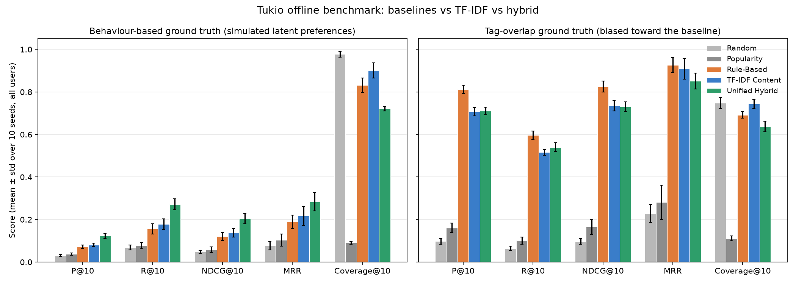

# Tukio Offline Evaluation

> Script: `backend/evaluate.py` | Raw results: `backend/results/evaluation.json`, `backend/results/evaluation.csv`
> Full generated tables (all cohorts, P@5 included): [`evaluation_results.md`](evaluation_results.md) | Chart: [`evaluation_chart.png`](evaluation_chart.png)
> Run date reference: 17 Oct 2026 (fixed so time-based features are deterministic) | 10 seeds (42–51) | Catalog: 160 seeded events



## 1. Question

Does Tukio's recommender (TF-IDF content model and the unified hybrid) rank events students will actually attend higher than a simple rule-based baseline? And does that result still hold when the test data is **not** generated by the baseline's own rule?

## 2. Models compared

| Model | File | What it uses |
| :--- | :--- | :--- |
| Random | `evaluate.py` | Nothing (reference floor) |
| Popularity | `evaluate.py` | Training-split RSVP counts (reference floor) |
| **Rule-Based** | `app/ml/baseline.py` | +3 category match, +2 per shared tag, +1 if within 14 days |
| **TF-IDF Content** | `app/ml/engine.py` | Cosine similarity between declared interests + titles of RSVP'd events and event text |
| **Unified Hybrid** | `app/ml/hybrid_engine.py` | TF-IDF content + TruncatedSVD collaborative + department + urgency + popularity |

The hybrid's blend weights are picked per seed from three fixed candidates by NDCG@10 on a validation split, never on the test split.

## 3. Method

### 3.1 Two ground-truth sets

**A. Behaviour-based ground truth (primary).** 60 simulated students per seed. Each one gets **hidden** preferences that the models never see:

| Hidden component | Weight | How it is drawn |
| :--- | :---: | :--- |
| Category taste | 0.45 | Dirichlet(0.6) over the 7 categories, so most students strongly like 1–3 categories |
| Taste cluster | 0.35 | One of 6 shared clusters. Half comes from hidden per-tag weights, half from an event-specific latent factor that no event text explains |
| Department | 0.10 | Bonus for events from the student's department (department follows the top category 70% of the time) |
| Event appeal | 0.10 | One hidden campus-wide appeal score per event |
| Noise | – | Gaussian, σ = 0.6, per student per event |

Each component is z-scored. The student "RSVPs" to the top 8–16 events by total utility. Models see only:
- **Declared interests:** a noisy, partial view. These are the names of 2–3 categories sampled by hidden taste, plus one tag each. Each declared tag has a 25% chance of being replaced by an unrelated tag.
- **Training-split RSVPs:** all of a student's training RSVPs, and other students' training RSVPs for the collaborative model.

The test relevance set is **only the student's held-out RSVPs**. The tag/category overlap rule is never used to build this set. A unit test (`test_behaviour_ground_truth_is_not_the_tag_overlap_rule`) checks that students RSVP to events that share no category or tag with their declared interests, which the rule-based ground truth cannot produce.

**B. Tag-overlap ground truth (secondary, biased toward the baseline).** This is the original `seed_ground_truth.json` from `seed.py`, run against the 22 seeded students. An event counts as "relevant" if its category is in the student's tags or it shares ≥ 2 tags with them. That is almost exactly the rule the Rule-Based baseline scores with, so the baseline is effectively being graded against its own answer key. It is kept so the bias is visible, not as evidence.

### 3.2 Splits and leakage control

- **Cohorts:** 35% of students are **cold-start** (1–2 training RSVPs). The rest are **warm** (60% of RSVPs for training).
- **Remaining RSVPs:** these are split 40% validation and 60% test.
- **Leakage:** held-out events never enter the student's profile, the SVD interaction matrix or popularity counts. This is verified by `test_held_out_events_never_appear_in_training_inputs` and `test_behaviour_splits_have_no_leakage`.
- **Candidates:** each student ranks the full catalog minus their own training events.

### 3.3 Metrics

- **Ranking metrics:** P@5, P@10, R@10, NDCG@10 and MRR are averaged per user, then averaged per seed.
- **Catalog Coverage@10:** the share of the 160-event catalog that appears in at least one user's top 10. This is a list-level diversity measure, computed once per seed. Higher means the system surfaces more of the campus calendar.
- **Spread:** every number is the **mean ± sample standard deviation across 10 seeds**.

## 4. Results

### 4.1 Behaviour-based ground truth (all 60 users)

| Model | P@5 | P@10 | R@10 | NDCG@10 | MRR | Coverage@10 |
| :--- | :---: | :---: | :---: | :---: | :---: | :---: |
| Random | 0.029 ± 0.010 | 0.031 ± 0.004 | 0.068 ± 0.011 | 0.048 ± 0.006 | 0.077 ± 0.019 | 0.978 ± 0.013 |
| Popularity | 0.035 ± 0.008 | 0.038 ± 0.006 | 0.078 ± 0.016 | 0.058 ± 0.014 | 0.103 ± 0.028 | 0.091 ± 0.006 |
| Rule-Based | 0.078 ± 0.015 | 0.073 ± 0.008 | 0.156 ± 0.024 | 0.120 ± 0.018 | 0.189 ± 0.032 | 0.833 ± 0.034 |
| TF-IDF Content | 0.088 ± 0.013 | 0.081 ± 0.008 | 0.178 ± 0.025 | 0.138 ± 0.021 | 0.217 ± 0.044 | **0.901 ± 0.035** |
| Unified Hybrid | **0.127 ± 0.014** | **0.123 ± 0.011** | **0.271 ± 0.025** | **0.204 ± 0.025** | **0.284 ± 0.044** | 0.721 ± 0.011 |

NDCG@10 by cohort:

| Model | Cold-start | Warm |
| :--- | :---: | :---: |
| Rule-Based | 0.131 ± 0.023 | 0.115 ± 0.023 |
| TF-IDF Content | 0.127 ± 0.013 | 0.145 ± 0.032 |
| Unified Hybrid | **0.196 ± 0.029** | **0.208 ± 0.034** |

### 4.2 Tag-overlap ground truth (all 22 seeded users, biased toward the baseline)

| Model | P@5 | P@10 | R@10 | NDCG@10 | MRR | Coverage@10 |
| :--- | :---: | :---: | :---: | :---: | :---: | :---: |
| Random | 0.088 ± 0.018 | 0.097 ± 0.013 | 0.064 ± 0.010 | 0.097 ± 0.013 | 0.228 ± 0.042 | 0.747 ± 0.027 |
| Popularity | 0.176 ± 0.057 | 0.161 ± 0.022 | 0.101 ± 0.017 | 0.165 ± 0.036 | 0.281 ± 0.081 | 0.111 ± 0.011 |
| Rule-Based | **0.831 ± 0.033** | **0.812 ± 0.020** | **0.597 ± 0.019** | **0.825 ± 0.026** | **0.926 ± 0.035** | 0.692 ± 0.015 |
| TF-IDF Content | 0.765 ± 0.041 | 0.707 ± 0.019 | 0.516 ± 0.013 | 0.736 ± 0.025 | 0.908 ± 0.049 | **0.744 ± 0.020** |
| Unified Hybrid | 0.755 ± 0.036 | 0.710 ± 0.018 | 0.540 ± 0.020 | 0.730 ± 0.022 | 0.852 ± 0.037 | 0.638 ± 0.025 |

### 4.3 Sensitivity check: is the simulator rigged for the hybrid?

The behaviour simulator includes department and event appeal, and the hybrid has features for both. To check that this is not what makes the hybrid win, the behaviour benchmark was re-run (5 seeds, all users) with the hidden utility changed:

NDCG@10 and MRR, all users. "Default" is the 10-seed main run; the two variants use 5 seeds (`backend/evaluate_sensitivity.py`).

| Hidden utility | Rule-Based NDCG@10 | TF-IDF NDCG@10 | Hybrid NDCG@10 | Rule-Based MRR | TF-IDF MRR | Hybrid MRR | Hybrid Coverage@10 |
| :--- | :---: | :---: | :---: | :---: | :---: | :---: | :---: |
| Default (category .45, cluster .35, dept .10, appeal .10) | 0.120 ± 0.018 | 0.138 ± 0.021 | **0.204 ± 0.025** | 0.189 ± 0.032 | 0.217 ± 0.044 | **0.284 ± 0.044** | 0.721 ± 0.011 |
| Category only (1.0) | 0.134 ± 0.020 | 0.165 ± 0.016 | **0.245 ± 0.043** | 0.189 ± 0.033 | 0.235 ± 0.026 | **0.299 ± 0.055** | 0.738 ± 0.022 |
| No dept, no appeal (category .55, cluster .45) | 0.142 ± 0.031 | 0.157 ± 0.026 | **0.178 ± 0.025** | 0.236 ± 0.053 | 0.249 ± 0.058 | **0.250 ± 0.046** | 0.693 ± 0.021 |

**Reading:** with category-only taste the hybrid still leads clearly. Its collaborative term and the category of the events a student RSVP'd to recover the hidden category taste better than declared interests do. But when the department and appeal signals are removed and the hidden cluster factor carries 45% of the utility, the hybrid's lead **shrinks to about one standard deviation** on NDCG@10 (0.178 vs 0.157 TF-IDF) and **disappears on MRR** (0.250 vs 0.249). So part of the default-run margin comes from simulator signals (department and campus-wide appeal) that the hybrid is built to exploit. The ordering Hybrid ≥ TF-IDF ≥ Rule-Based holds in every variant, but the size of the gap depends on assumptions about student behaviour that only real data can settle.

## 5. Where the hybrid wins and where it does not

**Wins**
- **Accuracy on behaviour data:** on the behaviour-based ground truth the hybrid is best on every accuracy metric, overall and in both cohorts. Its NDCG@10 of 0.204 is +70% over Rule-Based (0.120) and +48% over TF-IDF (0.138). The gaps are several seed standard deviations wide.
- **Cold-start:** the hybrid is clearly ahead for cold-start students too (NDCG@10 0.196 vs 0.131), even though they only have 1–2 RSVPs. This benchmark does not separate the contribution of each hybrid component. A per-component ablation would be needed to say which term drives the cold-start gain.
- **Same order in every simulator variant:** in the sensitivity check, the order Hybrid ≥ TF-IDF ≥ Rule-Based holds in every variant, including category-only taste, the case closest to what the rule-based baseline assumes.

**Does not win**
- **Lead shrinks without department and appeal signals:** in the sensitivity variant without them (§4.3), the hybrid's NDCG@10 lead over TF-IDF falls to about one standard deviation and MRR is a tie. The large default margin is partly a product of the simulator's assumptions.
- **Tag-overlap ground truth:** on this set the **Rule-Based baseline wins every accuracy metric** (NDCG@10 0.825 vs 0.730 hybrid and 0.736 TF-IDF). The hybrid also loses to TF-IDF on MRR (0.852 vs 0.908) and is worst of the three for cold-start students (NDCG@10 0.647 vs 0.755). This is expected, because that set is defined by the baseline's own rule. It still shows that when declared interests really are a perfect description of what students want, a simple rule is hard to beat.
- **Catalog coverage:** on **both** ground-truth sets the hybrid has the **lowest coverage** of the three main models (0.721 vs TF-IDF 0.901 on behaviour data; 0.638 vs 0.744 on tag-overlap). The popularity and collaborative terms pull many users toward the same events. TF-IDF surfaces the widest slice of the campus calendar. If discovery of niche events matters, the hybrid needs a diversity term (for example MMR re-ranking) or a smaller popularity weight.
- **TF-IDF alone is only a small step up:** on behaviour data TF-IDF beats Rule-Based by about 0.02 NDCG@10, which is about one seed standard deviation. Cold-start TF-IDF is slightly *below* Rule-Based (0.127 vs 0.131). Most of the gain comes from the hybrid's extra signals, not from TF-IDF.

## 6. Limitations

1. **Both ground-truth sets are synthetic.** The behaviour simulator removes the baseline's structural advantage, but it is still a model of students that I designed. Its parameters (cluster count, noise, weights) were chosen by hand and are not fitted to DeKUT data. Section 4.3 shows the size of the hybrid's lead depends on those choices. Only real RSVP/click logs, or an online A/B test, can say how Tukio performs with real students.
2. **Absolute accuracy on behaviour data is low.** The best model scores P@10 = 0.123, i.e. about 1 of the top 10 events is one the student RSVPs to. This reflects heavy noise and hidden factors that no model can see, by design. Compare models on this set against each other, not against the tag-overlap numbers.
3. **Most catalog events are in the past relative to the reference date.** 112 of the 160 seeded events start before 17 Oct 2026. The hybrid's urgency term clamps past events to maximum urgency, which adds noise against the hybrid on both sets. In the live app the feed only shows upcoming events, so this does not affect users. A future re-seed should place events after the reference date.
4. **Small populations.** There are 22 seeded students in the tag-overlap set and 60 simulated students per seed in the behaviour set. The ± values show seed-to-seed spread, not a significance test.
5. **Weight selection is coarse.** The hybrid chooses between only three fixed weight sets on the validation split. The "high content" set was selected in 6 of 10 seeds on both ground truths.
6. **Coverage depends on the catalog.** Random reaches ~0.98 coverage, and coverage says nothing about relevance. Read it alongside the accuracy metrics.

## 7. Reproducing

```powershell
cd backend
$env:APP_ENV = "development"
python seed.py       # only if the database is empty
python evaluate.py   # about 8 minutes; writes results/ and docs/evaluation_results.md + evaluation_chart.png
python evaluate_sensitivity.py   # about 4 minutes; prints the section 4.3 variants
python -m pytest tests/test_tukio_evaluation.py -q
```
