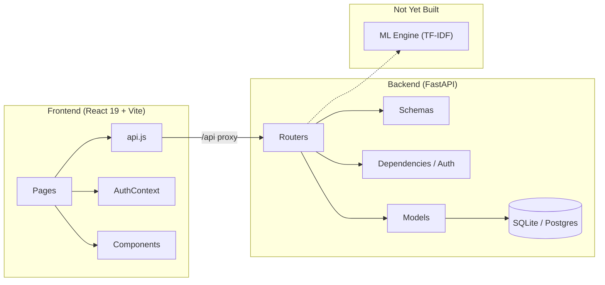

# DeKUT Event Management System — Project Status

> **Date:** 16 July 2026  
> **README says:** Stage 1 (Project Setup)  
> **Actual state:** Well into **Stage 2–3** — core CRUD & auth are built and wired end-to-end.

---

## What's Built

### Backend (FastAPI + SQLAlchemy + SQLite dev DB)

| Layer | Files | Status |
|---|---|---|
| **Models** | [user.py](file:///c:/Users/ADMIN/Documents/SEM%204.1/PROJECT/antigravity%20iteration/backend/app/models/user.py), [event.py](file:///c:/Users/ADMIN/Documents/SEM%204.1/PROJECT/antigravity%20iteration/backend/app/models/event.py), [rsvp.py](file:///c:/Users/ADMIN/Documents/SEM%204.1/PROJECT/antigravity%20iteration/backend/app/models/rsvp.py) | ✅ Complete — User, Event, RSVP with relationships & cascades |
| **Schemas** | [user.py](file:///c:/Users/ADMIN/Documents/SEM%204.1/PROJECT/antigravity%20iteration/backend/app/schemas/user.py), [event.py](file:///c:/Users/ADMIN/Documents/SEM%204.1/PROJECT/antigravity%20iteration/backend/app/schemas/event.py), [rsvp.py](file:///c:/Users/ADMIN/Documents/SEM%204.1/PROJECT/antigravity%20iteration/backend/app/schemas/rsvp.py), [token.py](file:///c:/Users/ADMIN/Documents/SEM%204.1/PROJECT/antigravity%20iteration/backend/app/schemas/token.py) | ✅ Complete — Pydantic v2 request/response models |
| **Routers** | [auth.py](file:///c:/Users/ADMIN/Documents/SEM%204.1/PROJECT/antigravity%20iteration/backend/app/routers/auth.py), [events.py](file:///c:/Users/ADMIN/Documents/SEM%204.1/PROJECT/antigravity%20iteration/backend/app/routers/events.py), [rsvps.py](file:///c:/Users/ADMIN/Documents/SEM%204.1/PROJECT/antigravity%20iteration/backend/app/routers/rsvps.py), [users.py](file:///c:/Users/ADMIN/Documents/SEM%204.1/PROJECT/antigravity%20iteration/backend/app/routers/users.py) | ✅ Complete — Full CRUD + pagination + filtering |
| **Auth** | [services/auth.py](file:///c:/Users/ADMIN/Documents/SEM%204.1/PROJECT/antigravity%20iteration/backend/app/services/auth.py), [dependencies.py](file:///c:/Users/ADMIN/Documents/SEM%204.1/PROJECT/antigravity%20iteration/backend/app/dependencies.py) | ✅ Complete — JWT + bcrypt + role-based guards |
| **DB** | [database.py](file:///c:/Users/ADMIN/Documents/SEM%204.1/PROJECT/antigravity%20iteration/backend/app/database.py), [config.py](file:///c:/Users/ADMIN/Documents/SEM%204.1/PROJECT/antigravity%20iteration/backend/app/config.py) | ✅ Complete — SQLite for dev, config for Supabase/Postgres |
| **Migrations** | [alembic/](file:///c:/Users/ADMIN/Documents/SEM%204.1/PROJECT/antigravity%20iteration/backend/alembic) | ✅ Set up |

### Frontend (React 19 + Vite 8 + React Router 7)

| Area | Files | Status |
|---|---|---|
| **Auth flow** | [LoginPage.jsx](file:///c:/Users/ADMIN/Documents/SEM%204.1/PROJECT/antigravity%20iteration/frontend/src/pages/LoginPage.jsx), [RegisterPage.jsx](file:///c:/Users/ADMIN/Documents/SEM%204.1/PROJECT/antigravity%20iteration/frontend/src/pages/RegisterPage.jsx), [AuthContext.jsx](file:///c:/Users/ADMIN/Documents/SEM%204.1/PROJECT/antigravity%20iteration/frontend/src/context/AuthContext.jsx) | ✅ Login, register, JWT-in-localStorage, auth context |
| **Event browsing** | [EventsPage.jsx](file:///c:/Users/ADMIN/Documents/SEM%204.1/PROJECT/antigravity%20iteration/frontend/src/pages/EventsPage.jsx), [EventCard.jsx](file:///c:/Users/ADMIN/Documents/SEM%204.1/PROJECT/antigravity%20iteration/frontend/src/components/EventCard.jsx) | ✅ Paginated list with cards |
| **Event detail** | [EventDetailPage.jsx](file:///c:/Users/ADMIN/Documents/SEM%204.1/PROJECT/antigravity%20iteration/frontend/src/pages/EventDetailPage.jsx) | ✅ Full detail view with RSVP |
| **Event creation** | [CreateEventPage.jsx](file:///c:/Users/ADMIN/Documents/SEM%204.1/PROJECT/antigravity%20iteration/frontend/src/pages/CreateEventPage.jsx) | ✅ Organizer/admin-gated form |
| **Dashboard** | [DashboardPage.jsx](file:///c:/Users/ADMIN/Documents/SEM%204.1/PROJECT/antigravity%20iteration/frontend/src/pages/DashboardPage.jsx) | ✅ Protected user dashboard |
| **Navigation** | [Navbar.jsx](file:///c:/Users/ADMIN/Documents/SEM%204.1/PROJECT/antigravity%20iteration/frontend/src/components/Navbar.jsx) | ✅ Responsive navbar with auth awareness |
| **Route guards** | [ProtectedRoute.jsx](file:///c:/Users/ADMIN/Documents/SEM%204.1/PROJECT/antigravity%20iteration/frontend/src/components/ProtectedRoute.jsx) | ✅ Role-based protected routes |
| **API client** | [api.js](file:///c:/Users/ADMIN/Documents/SEM%204.1/PROJECT/antigravity%20iteration/frontend/src/api.js) | ✅ Full client (auth, events, RSVPs) with Vite proxy |
| **Notifications** | [Toast.jsx](file:///c:/Users/ADMIN/Documents/SEM%204.1/PROJECT/antigravity%20iteration/frontend/src/components/Toast.jsx) | ✅ Toast component |
| **Styling** | [index.css](file:///c:/Users/ADMIN/Documents/SEM%204.1/PROJECT/antigravity%20iteration/frontend/src/index.css) + per-component CSS | ✅ Vanilla CSS (no Tailwind despite README mention) |

---

## What's NOT Built Yet

| Feature | Notes |
|---|---|
| 🔴 **ML Recommendation Engine** | README mentions a `/ml` directory — it does **not exist** in the workspace. No TF-IDF or cosine similarity code. |
| 🔴 **Event edit/update UI** | Backend `PATCH /events/{id}` exists, but there's no `EditEventPage` on the frontend. |
| 🟡 **Search & filter UI** | Backend supports `?search=` and `?category=`, but need to verify the frontend exposes these controls. |
| 🟡 **Admin panel / user management** | Backend has `users/` router but no admin-facing UI for managing roles/users. |
| 🟡 **Image upload** | `image_url` field exists in the Event model, but there's no file upload flow — it's just a URL string. |
| 🟡 **PostgreSQL / Supabase** | Config is ready but dev is running on a local SQLite file (`dekut_events.db`). |
| 🟡 **PWA configuration** | README says "configured as a PWA" but no `manifest.json` or service worker was found. |
| 🟡 **Tests** | `pytest` is in requirements, but no test files exist. |
| 🟡 **README is out of date** | Still says "Stage 1: Project Setup" — the project is far beyond that. |

---

## Architecture Diagram

---

## Summary

You've completed the **core full-stack CRUD application** — auth, events, RSVPs, routing, and role-based access are all wired up. The biggest remaining piece is the **ML recommendation engine**, followed by polish items like an edit-event UI, image uploads, search/filter controls, testing, and the Supabase/Postgres migration.
